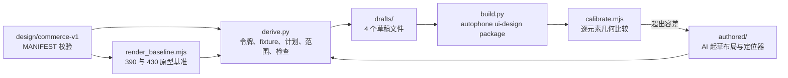

# commerce-v1 A01 设计输入（430×932 重排，R4）

本目录把冻结设计包 `design/commerce-v1/` 中 A01 批次的页面状态转换为 autophone 结构化设计包（`structured-design-package/v1`）。设计版本为 `commerce-v1-a01-430/r4`：画布从原包的 390×844 重排到 430×932，作为新设计版本处理，不改写原包。

状态：2026-11-06，`home.default.v1` 已打包，第 2 轮**几何**校准通过（范围见 §3；不代表视觉一致）。验收范围尚未与批次合同做覆盖检查，见 G7。`home.guest.v1` 与 `orders.empty.v1` 缺少设计决定，暂未起草，见 [§5](#5-映射缺口与待定设计决定)。本目录不执行 design lock，也不包含需求输入包；这两项由 B4 及后续流程完成。

## 1. 流程



| 部分 | 产生方式 | 位置 |
| --- | --- | --- |
| 原型基准 | 确定性渲染：同一份 `ui/prototype.html` 以 `?embed&width=<w>` 渲染，记录每个节点的盒子、计算样式和文本 | `baseline/<page>/prototype-{390,430}.{json,png}` |
| 令牌 | 确定性：`spec/design-tokens.json` → DSL 令牌 | `derived/tokens.json` |
| Fixture | 确定性：`fixtures/*` 取数据值；显示文本由定位器从 430 基准中提取 | `drafts/<state>/state-fixture.json` |
| 页面计划 | 确定性：`spec/view-models.json` 区块，加原型中的页头与导航外壳 | `derived/screen-plan.<screen>.json` |
| 验收范围 | 确定性：`ui-contract.json` 控件、`acceptance-cases.json` 用例、导航别名 | `derived/acceptance-scope.json` |
| 布局树 | AI 起草（`claude-opus-5-5`），依据 [authored/AUTHORING.md](authored/AUTHORING.md) | `authored/<state>/layout.json` |
| 文本与校准定位器 | AI 起草，提取结果由脚本校验唯一性 | `authored/<state>/bindings.json` |
| 设计包 | 确定性：autophone `ui-design package` | `packages/<state>/round-<n>/` |
| 校准记录 | 确定性：编译结果与 430 基准逐元素比较 | `calibration/<state>/round-<n>.{json,png}` |

`derive.py` 先按 `MANIFEST.json`（SHA-256 `ec6bed1c…`）重算原包 54 个文件，任一不一致即停止。草稿的 `ai_provenance.prompt_sha256` 取 `authored/AUTHORING.md` 的哈希。

## 2. 重新生成

```sh
cd .autophone/feature-designs/commerce-v1-a01
export PLAYWRIGHT_MODULE=<autophone>/node_modules/playwright/index.mjs
BASELINE_VIEWPORT=390x844 node tools/render_baseline.mjs ../../../design/commerce-v1/ui/prototype.html baseline home orders
node tools/render_baseline.mjs ../../../design/commerce-v1/ui/prototype.html baseline home orders
python3 -I tools/derive.py            # 写 derived/ 与 drafts/
python3 -I tools/derive.py --check    # 只核对，不写
python3 tools/build.py --autophone-root <autophone> --round <n>
```

2026-11-06 的两次实验中，重新渲染的 430 基准 JSON 与 PNG 字节一致，同一草稿两次打包的 `design-package.json` 哈希一致。评审复核时观察到同版本 Chromium、同一 URL 重复渲染 DOM 相同而部分像素不同（最大通道差 17/255），原因未查明；以上结果只作实验记录，不作可重复性保证。`build.py` 每轮写入新目录，同一轮号已存在时拒绝执行。本仓库不依赖 Playwright，渲染与校准使用 autophone 的 Playwright（`playwright/1.61.1`、`chromium/149.0.7827.55`）。

## 3. 校准轮次（home.default.v1）

坐标比较前按视口画像做两处区域平移，平移量写在 `bindings.json`：

| 区域 | 原型 | 草稿 | 原因 |
| --- | --- | --- | --- |
| 顶部 | 内容起点 y=44（模拟状态栏） | y=59（顶部安全区） | 系统区域由平台视口画像提供 |
| 底部导航 | 导航顶 y=856，高 76（含 17 底部内边距） | y=836，高 59 | 底部内边距由 37pt 安全区取代，按钮区保持 59pt |

容差：盒子类元素 x、y、宽、高各 ≤2pt；文本类元素 x 与垂直中心 ≤3pt（宽度只记录不判定，原型的行内元素与 DSL Text 宽度定义不同）。

校准范围只有几何：不比较文字内容、颜色、字号、字重、文本宽度、行数与截断，也不检查图标、插画和滚动可达性。区域平移与容差目前写在 AI 起草的 `bindings.json` 中，应改为校准前固定的独立策略文件，变更时生成新版本。

| 轮次 | 结果 | 原因与修正 |
| --- | --- | --- |
| 1 | 13/30 通过 | 第一屏以下元素整体上移约 61pt。内容区为 flex 列，溢出时带 `overflow:hidden` 的子项（主推卡、商品卡）被压缩；原型的滚动区是普通 block，不压缩。修正：内容区内加一层不限高的内层列 `home.scroll`；会员条文字行高度改为原型的 19.14pt（原差 1.14pt） |
| 2 | 30/30 通过 | 设计包 `design-package.json` SHA-256 `9f1ce285…`，26 个元素、75 个属性，0 个映射缺口；两次独立打包哈希一致 |

第 1 轮的草稿没有单独保存，修正内容即上表所列两处；其校准记录保留在 `calibration/home.default.v1/round-1.json`。

## 4. 确定性检查的发现

| 检查 | 结果 | 文件 |
| --- | --- | --- |
| 原型用到的值是否在设计令牌内 | 首页文本字号 10 种中 8 种不在令牌内（令牌只有 12/13/15/20/28/34）；颜色 14 种中 7 种不在；圆角 6 种中 5 种不在（其中 30pt 属于原型的模拟状态栏） | `derived/token-coverage.json` |
| 原型文本与 fixture 是否一致 | 9 项中 2 项字符串不同：主推价格原型为 `¥32.9`，脚本按两位小数格式化 `base_price_cents=3290` 得 `¥32.90`，金额相同，差异在显示格式；门店名原型为简称 `科创园店`，fixture 为全称 `食刻 · 科创园店（演示）`。两项都缺显示规则，不能判为数据错误；脚本的两位小数格式是本工具的假设 | `derived/input-checks.json` |
| 390→430 重排差异 | 上半区元素只有宽度与 x 变化（两列卡片各宽 20pt，右列右移 20pt）；导航随视口变高下移 88pt | `derived/relayout-r4.json` |
| 原包 PNG 与 390 重渲染 | 布局结构一致，文字位置有 2–3pt 差异。原因待验证：原包截图脚本未记录实际字体，`design-tokens.json` 区分 `designFamily: Noto Sans SC` 与 `nativeFamily: system`；本基准也未记录实际解析字体。浏览器与 iOS 的字体一致性须由设备证据单独验证 | 本 README |

## 5. 映射缺口与待定设计决定

需要设计决定（暂停对应状态或保留原型值，未在草稿中自行选择）：

| 编号 | 内容 | 影响 | 当前处理 |
| --- | --- | --- | --- |
| G1 | 原型首页不区分游客与默认态；`state` 参数不影响首页。游客的会员条（"3 张券"）显示什么未定义 | `home.guest.v1`（T001）无法起草 | 暂停 |
| G2 | 原型订单页没有空态：`page=orders&state=empty` 与默认态渲染结果相同 | `orders.empty.v1`（T004）无法起草 | 暂停；默认态基准已渲染 |
| G3 | 原型大量使用设计令牌以外的字号、颜色、圆角（§4） | 实现应以令牌还是原型为准未定 | 草稿取原型值，写为 `proto.*` 局部令牌 |
| G4 | 价格与门店名缺显示规则（§4）：需要区分业务值（`base_price_cents`、门店 ID）、显示规则（金额格式、全称或简称）与显示结果 | 实现按不同规则显示时会与参考图不符 | 草稿取原型文本；Fixture 中的显示文本只消除了转抄错误，不证明符合业务数据 |
| G5 | `home.store.select` 高 21.8pt，`ui-contract.json` 要求最小触控 44pt | 触控目标检查与参考图冲突 | 草稿取原型几何 |
| G6 | 商品卡保留了按钮默认内边距（上下 1pt、左右 6pt），插画区左右留白，疑似非设计意图 | 实现若去掉留白会与参考图不符 | 草稿按原型保留 |
| G7 | 最终验收 targets 取自 AI 起草的 `layout.json`，校准元素取自起草的 `bindings.json`，两者都没有与批次合同建立强制覆盖关系：契约控件 `home.store.select`、`home.ai.open` 不在验收 targets 中；`build.py` 对未起草状态只标记跳过、不返回失败。“0 个映射缺口”只说明已声明 targets 的映射完整 | 设计包可能缺少内容而检查仍通过 | 待补：从批次合同独立生成必需状态、元素、属性集合，覆盖缺口分为未完成、平台不支持、合同明确排除 |

2026-11-06 设计决定（用户按建议确认；作为新设计版本补入，来源记为本次决定，不改写原包）：

| 编号 | 决定 |
| --- | --- |
| D1（G1） | 游客首页与默认态布局相同；会员条显示登录引导，不显示券数量 |
| D2（G2） | 订单空态：文案“还没有订单”，主操作“去点餐”（`orders.empty.primary_action`，跳转点餐） |
| D3（G4） | 金额统一显示两位小数（`¥32.90`）；Fixture 增加门店简称字段，首页显示简称“科创园店” |
| D4（P1–P5） | 先用 `home.default.v1` 验证平台已有的 v1 HTML 草稿路径（直接打包原型 HTML，加 `data-stable-id` 注入适配器），与当前 DSL 产物并排比较后，再决定扩展 DSL 还是采用 HTML 适配器 |

平台表达能力限制（属 autophone 能力，按 R3 规则可在 autophone 建任务）：

| 编号 | 内容 | 当前处理 |
| --- | --- | --- |
| P1 | 注册组件不能表达图标与插画（定位、箭头、消息、模式图标、导航图标、主推插画、商品插画、AI 图标） | 以无样式 Decoration 保持尺寸，不进入验收；参考图中这些区域为空，像素比较须在 P1 校准时处理 |
| P2 | Text 不支持强制换行 | 主推标题拆成 `home.hero.headline.line1`、`line2` 两个文本 |
| P3 | 字重只允许 100 的整数倍 | 原型 850、750 分别取 800、700 |
| P4 | 单个 Text 只有一种样式 | 商品价格中 12pt 的 `¥` 与 18pt 数字合并为 18pt |
| P5 | 导航图标无法表达，标签垂直位置按 24pt 上内边距近似，未校准 | 导航只校准按钮盒子 |

其他说明：

- `home.ai.open` 位于首屏底部，被导航遮挡大部分，保留节点但不进入验收；滚动后是否可达未验证。
- 新增的文本 `stable_id`（如 `home.store.name`、`home.mode.pickup.title`、`home.shelf.<productId>.price`）在控件或区块命名空间下命名，列在草稿的验收范围中；会员条使用视图模型给出的 `member.points.open`。
- 交付方案批次 1 所列 T039–T042 的起始状态分别属于 cart、ai、checkout 页面（native 层），不在 A01 的首页与订单页范围内；按起始 `state_id` 分类后仍需核对跨页面依赖（例如 T003 涉及五条导航路由）。
- 设备语言已于 2026-11-06 由用户手动切换为 zh-CN，与 fixture 的 `locale` 一致；切换后的采集环境尚未经工作流验证，见 `docs/commerce-v1/environment.md`。
