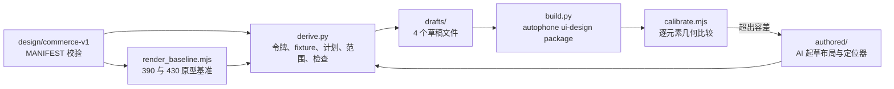

# commerce-v1 A01 设计输入（430×932 重排，R4）

本目录把冻结设计包 `design/commerce-v1/` 中 A01 批次的页面状态转换为 autophone 结构化设计包（`structured-design-package/v1`）。设计版本为 `commerce-v1-a01-430/r4`：画布从原包的 390×844 重排到 430×932，作为新设计版本处理，不改写原包。

状态：2026-11-06 第 6 轮（策略 v4），A01 三个状态均通过批次准入；校准 0 失败：`home.default.v1` 26 通过、7 已登记偏差，`home.guest.v1` 25 通过、8 已登记偏差，`orders.empty.v1` 9 通过、1 已登记偏差（§3）。游客首页与订单空态按设计决定 D1、D2 起草；显示规则按 D3 生效。本目录不执行 design lock，也不包含需求输入包。

## 1. 流程



| 部分 | 产生方式 | 位置 |
| --- | --- | --- |
| 原型基准 | 确定性渲染：同一份 `ui/prototype.html` 以 `?embed&width=<w>` 渲染，记录每个节点的盒子、计算样式和文本 | `baseline/<page>/prototype-{390,430}.{json,png}` |
| 令牌 | 确定性：`spec/design-tokens.json` → DSL 令牌 | `derived/tokens.json` |
| Fixture | 确定性：`fixtures/*` 取数据值；显示文本由定位器从 430 基准中提取 | `drafts/<state>/state-fixture.json` |
| 页面计划 | 确定性：`spec/view-models.json` 区块，加原型中的页头与导航外壳 | `derived/screen-plan.<screen>.json` |
| 验收范围 | 确定性：`ui-contract.json` 控件、`acceptance-cases.json` 用例、导航别名 | `derived/acceptance-scope.json` |
| 设计决定 | 用户确认的决定 D1–D6：显示规则、Fixture 补充、文案覆盖与新增、模板取值 | `decisions/a01-decisions.json` |
| 批次合同 | 确定性：冻结设计包加设计决定，不读草稿 | `derived/batch-contract.json` |
| 解析后的映射 | 确定性：`authored/<state>/bindings.json` 展开 `extends` 后的结果，供校准与准入使用 | `derived/bindings/<state>.json` |
| 布局树 | AI 起草（`claude-opus-5-5`），依据 [authored/AUTHORING.md](authored/AUTHORING.md) | `authored/<state>/layout.json` |
| 文本与校准定位器 | AI 起草，提取结果由脚本校验唯一性 | `authored/<state>/bindings.json` |
| 设计包 | 确定性：autophone `ui-design package` | `packages/<state>/round-<n>/` |
| 校准记录 | 确定性：编译结果与 430 基准逐元素比较 | `calibration/<state>/round-<n>.{json,png}` |

`derive.py` 先按 `MANIFEST.json`（SHA-256 `ec6bed1c…`）重算原包 54 个文件，任一不一致即停止。草稿的 `ai_provenance.prompt_sha256` 取 `authored/AUTHORING.md` 的哈希。

## 2. 重新生成

```sh
cd .autophone/feature-designs/commerce-v1-a01
export PLAYWRIGHT_MODULE=<autophone>/node_modules/playwright/index.mjs
export COMPOSITOR_PROFILES=<autophone>/autophone/workflow/requirement/prototype_compositor.json
BASELINE_VIEWPORT=390x844 node tools/render_baseline.mjs ../../../design/commerce-v1/ui/prototype.html baseline home orders
node tools/render_baseline.mjs ../../../design/commerce-v1/ui/prototype.html baseline home orders
python3 -I tools/derive.py            # 写 derived/（含批次合同）与 drafts/
python3 -I tools/derive.py --check    # 只核对产物是否过期，不判设计有效性
python3 tools/build.py --autophone-root <autophone> --round <n> --policy policy/calibration-policy.v2.json
python3 -I tools/admission.py         # 单独执行批次准入
python3 tools/calibration_selftest.py --autophone-root <autophone> --policy policy/calibration-policy.v2.json
python3 -I tools/check_render_determinism.py --runs 5
```

`build.py` 每轮写入新目录（设计包、校准记录、对照图、本轮输入快照 `round-<n>-inputs/`），同一轮号已存在时拒绝执行；校准失败或任一必需状态未准入时返回 1。本仓库不依赖 Playwright，渲染与校准使用 autophone 的 Playwright（`playwright/1.61.1`、`chromium/149.0.7827.55`），Chromium 启动参数取 autophone `prototype_compositor.json` 的打包配置（`software/v1`：`--disable-gpu --disable-gpu-compositing`），与平台参考图渲染相同。

## 3. 批次准入与校准

### 3.1 批次准入（B3a）

`derive.py` 只从冻结设计包生成 `derived/batch-contract.json`：每个 A01 状态的必需元素来自 `ui-contract.json` 控件、`view-models.json` 区块与底部导航；模板 ID 按设计包给出的取值展开（首页商品取原型渲染的前两个），取不到的记为合同未解析；排除项写明理由与来源。`admission.py` 不读 AI 起草的范围，逐项归类：

| 类别 | 含义 | 是否阻断 |
| --- | --- | --- |
| covered | 已生成 `stable_id`、进入验收 targets，且有校准映射 | 否 |
| incomplete | 状态未起草、元素未生成、生成未验收、验收未校准，或合同未解析 | 是 |
| platform_unsupported | 原型 430 渲染中的图标与插画（按基准里的 SVG 统计，不看草稿） | 否，单独报告，不计为覆盖 |
| excluded | 合同排除，附理由与来源 | 否 |

2026-11-06 第 6 轮准入结果（`admission/admission-report.json`）：三个状态均准入。`home.default.v1`、`home.guest.v1` 各覆盖 13 项；`orders.empty.v1` 覆盖 9 项，`orders.empty.primary_action` 依据 D2 新增、无原型基准（covered_by_decision），订单行按空态配方排除，筛选 ID 按 D6 展开。图标与插画首页 13 处、订单页 8 处，单独报告。第 4 轮时 `home.ai.open` 待 G8、两个状态未起草，三者均未准入。

### 3.2 校准策略与检查项

区域平移、容差、判定项与已知偏差写在 `policy/calibration-policy.v<n>.json`，与 AI 起草的 `bindings.json`（只负责 `stable_id` 到基准节点的映射）分开；任何改动生成新版本文件，已知偏差必须引用 §5 已登记的缺口。

| 区域 | 原型 | 草稿 | 原因 |
| --- | --- | --- | --- |
| 顶部 | 内容起点 y=44（模拟状态栏） | y=59（顶部安全区） | 系统区域由平台视口画像提供 |
| 底部导航 | 导航顶 y=856，高 76（含 17 底部内边距） | y=836，高 59 | 底部内边距由 37pt 安全区取代，按钮区保持 59pt |

| 检查 | 内容 | 阈值 |
| --- | --- | --- |
| geometry | 盒子：x、y、宽、高；文本：x 与垂直中心（宽度只记录） | 盒子 2pt，文本 3pt |
| text | 渲染文本与基准文本相同 | 完全一致 |
| style | 文本的颜色、字号、字重；盒子的背景色 | 完全一致 |
| lines | 行数、截断、遮挡（可见部分中心点命中） | 完全一致 |
| visibility | 视口与裁剪祖先内的可见比例 | 差 ≤0.1 |
| font | 两侧实际解析出的主字体族 | 只记录 |

| 版本 | 变化 |
| --- | --- |
| v1 | 不含已知偏差 |
| v2 | 登记 v1 首次运行发现的 5 项：4 处字重（P3）、`home.ai.open` 可见比例（G8） |
| v3 | 加入订单页区域；登记 D1、D3 带来的与原型差异与订单标题字重（P3）；共 17 项 |
| v4 | 每项偏差锁定登记时的实测值（文本与样式须相同，几何与可见比例在容差内），同一检查项的其他失败不再被豁免；缺锁定值的策略被拒绝 |

### 3.3 轮次（home.default.v1）

| 轮次 | 策略 | 结果 | 说明 |
| --- | --- | --- | --- |
| 1 | 仅几何（旧校准器） | 13/30 | 内容区 flex 列溢出时压缩了带 `overflow:hidden` 的子项；修正为内容区内加一层不限高的内层列 `home.scroll`，会员条文字行高改为 19.14pt |
| 2 | 仅几何（旧校准器） | 30/30 | 设计包 SHA-256 `9f1ce285…`，26 个元素、75 个属性 |
| 3 | v2 | 28 通过、5 已登记偏差、0 失败（33 项） | 扩展检查后首次正式轮；草稿未改，设计包哈希与第 2 轮相同 |
| 4 | v2 | 同上 | `home.store.select` 以背景色存在性断言进入验收 targets（内容撑开的盒子不声明 `frame.*`）；设计包 `79471d8c…` |
| 5 | v3 | 默认 26/7/0，游客 25/8/0，订单空态 9/1/0（通过/已登记偏差/失败） | 按 D5 接受 `home.ai.open`；按 D3 价格两位小数；新增游客首页与订单空态 |
| 6 | v4 | 同第 5 轮 | 偏差锁定实测值后的首轮 |

用 v1 对第 2 轮设计包运行扩展校准器的结果（28 通过、4 失败：3 处字重、`home.ai.open` 可见比例；当时人气区标题尚无校准映射，补上后为 4 处字重）是登记 v2 偏差的依据。第 1 轮草稿没有保存；从第 3 轮起每轮输入保存在 `calibration/home.default.v1/round-<n>-inputs/`。

### 3.4 校准器自检

`calibration_selftest.py` 从当前草稿出发各做一处受控改动，打包后校准。2026-11-06 分别用策略 v2、v3、v4 运行，结果全部符合预期；当前记录为 v4（`admission/calibration-selftest.json`）：

| 样本 | 改动 | 判定 | 命中的检查 |
| --- | --- | --- | --- |
| control | 无 | 通过 | — |
| text_changed | 问候语文本 | 失败 | `home.greeting` text |
| element_missing | 删除自取卡标题 | 失败 | presence；同卡副标题 geometry |
| shifted | 模式卡上移量 +5pt | 失败 | 以下元素 geometry |
| occluded | 自取卡内容上加不透明层 | 失败 | 标题与副标题 occluded |
| deviation_masking | 主推价格改为 `¥99.90`（该元素文本检查带 D3 偏差） | 失败 | `home.hero.price` text（锁定值不符，偏差不豁免） |
| wrong_state | 用订单页基准校准首页 | 失败 | locator |
| stale_evidence | 基准文件与派生记录摘要不符 | 拒绝（退出码 2） | 基准摘要核对 |

## 4. 确定性检查的发现

| 检查 | 结果 | 文件 |
| --- | --- | --- |
| 原型用到的值是否在设计令牌内 | 首页文本字号 10 种中 8 种不在令牌内（令牌只有 12/13/15/20/28/34）；颜色 14 种中 7 种不在；圆角 6 种中 5 种不在（其中 30pt 属于原型的模拟状态栏） | `derived/token-coverage.json` |
| 原型文本与 fixture 是否一致 | 9 项中 2 项字符串不同：主推价格原型为 `¥32.9`，脚本按两位小数格式化 `base_price_cents=3290` 得 `¥32.90`，金额相同，差异在显示格式；门店名原型为简称 `科创园店`，fixture 为全称 `食刻 · 科创园店（演示）`。两项都缺显示规则，不能判为数据错误；脚本的两位小数格式是本工具的假设 | `derived/input-checks.json` |
| 390→430 重排差异 | 上半区元素只有宽度与 x 变化（两列卡片各宽 20pt，右列右移 20pt）；导航随视口变高下移 88pt | `derived/relayout-r4.json` |
| 原包 PNG 与 390 重渲染 | 布局结构一致，文字位置有 2–3pt 差异。原因待验证：原包截图脚本未记录实际字体，`design-tokens.json` 区分 `designFamily: Noto Sans SC` 与 `nativeFamily: system`；2026-11-06 起基准记录每个文本节点实际解析的字体（首页：PingFang SC 151 个字形、.SF NS 89 个、Menlo 4 个，后者来自模拟状态栏符号）。浏览器与 iOS 的字体一致性须由设备证据单独验证 | 本 README |
| 渲染可重复性 | 以 `software/v1` 合成参数在本机连续渲染 5 次（`chromium/149.0.7827.55`，darwin arm64）：JSON 与 PNG 字节一致，像素差 0。评审观察到的 17/255 差异发生条件未复现，可能与未使用该合成参数有关，未验证；结论只适用于本机与该工具链 | `admission/render-determinism.json` |

## 5. 映射缺口与待定设计决定

需要设计决定（暂停对应状态或保留原型值，未在草稿中自行选择）：

| 编号 | 内容 | 影响 | 当前处理 |
| --- | --- | --- | --- |
| G1 | 原型首页不区分游客与默认态；`state` 参数不影响首页。游客的会员条（"3 张券"）显示什么未定义 | `home.guest.v1`（T001）无法起草 | 已按 D1 处理：游客首页继承默认态布局，会员条文案改为“登录 ›”（措辞由 AI 选择，见决定文件 `authored_copy`） |
| G2 | 原型订单页没有空态：`page=orders&state=empty` 与默认态渲染结果相同 | `orders.empty.v1`（T004）无法起草 | 已按 D2 处理：订单空态依据原型卡片与次要按钮样式起草，空态内容无原型基准，不做校准 |
| G3 | 原型大量使用设计令牌以外的字号、颜色、圆角（§4） | 实现应以令牌还是原型为准未定 | 草稿取原型值，写为 `proto.*` 局部令牌 |
| G4 | 价格与门店名缺显示规则（§4）：需要区分业务值（`base_price_cents`、门店 ID）、显示规则（金额格式、全称或简称）与显示结果 | 实现按不同规则显示时会与参考图不符 | 已按 D3 处理：金额与门店简称由显示规则从业务值生成，与原型不同处记入 `derived/input-checks.json` 与策略偏差 |
| G5 | `home.store.select` 高 21.8pt，`ui-contract.json` 要求最小触控 44pt | 触控目标检查与参考图冲突 | 草稿取原型几何 |
| G6 | 商品卡保留了按钮默认内边距（上下 1pt、左右 6pt），插画区左右留白，疑似非设计意图 | 实现若去掉留白会与参考图不符 | 草稿按原型保留 |
| G7 | 最终验收 targets 取自 AI 起草的 `layout.json`，校准元素取自起草的 `bindings.json`，两者都没有与批次合同建立强制覆盖关系：契约控件 `home.store.select`、`home.ai.open` 不在验收 targets 中；`build.py` 对未起草状态只标记跳过、不返回失败。“0 个映射缺口”只说明已声明 targets 的映射完整 | 设计包可能缺少内容而检查仍通过 | 已实现批次合同与准入检查（§3.1）；第 6 轮三个状态均准入 |
| G8 | R4 重排以 59pt 顶部安全区与 37pt 底部安全区取代原型的 44pt 模拟状态栏与 17pt 导航底部内边距，首屏内容区少 35pt；`home.ai.open` 的可见比例从原型 430 渲染的 0.81 降到 0.22（几乎被导航遮挡）。由第 3 轮校准的可见比例检查发现 | 首屏底部入口是否需要完整可见未定 | 已按 D5 处理：接受部分可见，B4 以滚动后可达断言；策略以锁定值登记可见比例偏差 |

2026-11-06 设计决定（用户按建议确认；作为新设计版本补入，来源记为本次决定，不改写原包）：

| 编号 | 决定 |
| --- | --- |
| D1（G1） | 游客首页与默认态布局相同；会员条显示登录引导，不显示券数量 |
| D2（G2） | 订单空态：文案“还没有订单”，主操作“去点餐”（`orders.empty.primary_action`，跳转点餐） |
| D3（G4） | 金额统一显示两位小数（`¥32.90`）；Fixture 增加门店简称字段，首页显示简称“科创园店” |
| D4（P1–P5） | 先用 `home.default.v1` 验证平台已有的 v1 HTML 草稿路径（直接打包原型 HTML，加 `data-stable-id` 注入适配器），与当前 DSL 产物并排比较后，再决定扩展 DSL 还是采用 HTML 适配器。2026-11-06 验证结果见 [spike/README.md](spike/README.md) |
| D5（G8） | 接受 `home.ai.open` 在首屏部分可见；B4 验收以“滚动后可达”断言，不压缩上方间距 |
| D6（合同未解析） | 订单筛选 ID：`orders.filter.all`、`orders.filter.active`、`orders.filter.completed`、`orders.filter.after_sale`，对应原型“全部 / 进行中 / 已完成 / 售后” |

平台表达能力限制（属 autophone 能力，按 R3 规则可在 autophone 建任务）：

| 编号 | 内容 | 当前处理 |
| --- | --- | --- |
| P1 | 注册组件不能表达图标与插画（定位、箭头、消息、模式图标、导航图标、主推插画、商品插画、AI 图标） | 以无样式 Decoration 保持尺寸，不进入验收；参考图中这些区域为空，像素比较须在 P1 校准时处理 |
| P2 | Text 不支持强制换行 | 主推标题拆成 `home.hero.headline.line1`、`line2` 两个文本 |
| P3 | 字重只允许 100 的整数倍 | 原型 850、750 分别取 800、700 |
| P4 | 单个 Text 只有一种样式 | 商品价格中 12pt 的 `¥` 与 18pt 数字合并为 18pt |
| P5 | 导航图标无法表达，标签垂直位置按 24pt 上内边距近似，未校准 | 导航只校准按钮盒子 |

其他说明：

- `home.ai.open` 位于首屏底部，被导航遮挡大部分，保留节点但不进入验收；滚动后是否可达未验证。
- 新增的文本 `stable_id`（如 `home.store.name`、`home.mode.pickup.title`、`home.shelf.<productId>.price`）在控件或区块命名空间下命名，列在草稿的验收范围中；会员条使用视图模型给出的 `member.points.open`。
- 交付方案批次 1 所列 T039–T042 的起始状态分别属于 cart、ai、checkout 页面（native 层），不在 A01 的首页与订单页范围内；按起始 `state_id` 分类后仍需核对跨页面依赖（例如 T003 涉及五条导航路由）。
- 设备语言已于 2026-11-06 由用户手动切换为 zh-CN，与 fixture 的 `locale` 一致；切换后的采集环境尚未经工作流验证，见 `docs/commerce-v1/environment.md`。
