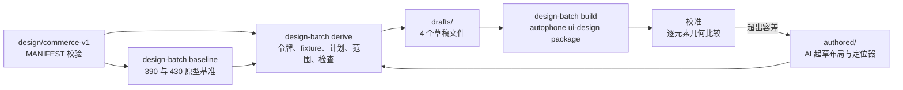

# commerce-v1 A01 设计输入（430×932 重排，R4）

本目录把冻结设计包 `design/commerce-v1/` 中 A01 批次的页面状态转换为 autophone 结构化设计包（`structured-design-package/v1`）。设计版本为 `commerce-v1-a01-430/r4`：画布从原包的 390×844 重排到 430×932，作为新设计版本处理，不改写原包。

状态：2026-11-06 第 14 轮（策略 v5，D9 平涂色遮罩，autophone `design-batch` 引擎），A01 三个状态均通过批次准入（含期望可实现性）、校准 0 失败。首页默认态与游客态走 HTML 路线：29/28 通过，3/4 项已登记偏差来自设计决定（D1、D3、D5），13 处图形均已交付；订单空态走 DSL 路线：9 通过、1 项已登记偏差（P3）。80 个文本节点均判为可实现，所用映射证据为“假设”，待设备证据。进入 B4 的检查清单以第 14 轮为起点（`final/b4-entry.json`），B4 验收合同见 §2.2。本目录不执行 design lock，也不包含需求输入包。

本目录只放数据与产物；派生、渲染、校准、准入与检查由 autophone `design-batch` 命令执行（2026-11-06 迁入，见 §2.1）。

## 1. 流程



| 部分 | 产生方式 | 位置 |
| --- | --- | --- |
| 原型基准 | 确定性渲染：同一份 `ui/prototype.html` 以 `?embed&width=<w>` 渲染，记录每个节点的盒子、计算样式和文本 | `baseline/<page>/prototype-{390,430}.{json,png}` |
| 令牌 | 确定性：`spec/design-tokens.json` → DSL 令牌 | `derived/tokens.json` |
| Fixture | 确定性：`fixtures/*` 取数据值；显示文本由定位器从 430 基准中提取 | `drafts/<state>/state-fixture.json` |
| 页面计划 | 确定性：`spec/view-models.json` 区块，加原型中的页头与导航外壳 | `derived/screen-plan.<screen>.json` |
| 验收范围 | 确定性：`ui-contract.json` 控件、`acceptance-cases.json` 用例、导航别名 | `derived/acceptance-scope.json` |
| 设计决定 | 用户确认的决定 D1–D6：显示规则、Fixture 补充、文案覆盖与新增、模板取值 | `decisions/a01-decisions.json` |
| 批次定义 | 批次事实与配置：状态与用例、外壳区块、导航、列表取值、当前门店、模板来源、显示绑定、合同排除、画布与视口画像；每项带 L0 出处或决定编号 | `batch/a01-batch.json` |
| 批次合同 | 确定性：冻结设计包加设计决定，不读草稿 | `derived/batch-contract.json` |
| 解析后的映射 | 确定性：`authored/<state>/bindings.json` 展开 `extends` 后的结果，供校准与准入使用 | `derived/bindings/<state>.json` |
| 布局树（DSL 路线） | AI 起草（`claude-opus-5-5`），依据 [authored/AUTHORING.md](authored/AUTHORING.md) | `authored/<state>/layout.json` |
| HTML 路线草稿 | 确定性：冻结原型加注入（查询参数、R4 外壳样式、`data-stable-id` 与决定文本），声明视口画像与验收 targets；验收 targets 与映射差异由 AI 起草 | `authored/<state>/html.json` → `drafts-html/<state>/` |
| 文本与校准定位器 | AI 起草，提取结果由脚本校验唯一性 | `authored/<state>/bindings.json` |
| 设计包 | 确定性：autophone `ui-design package` | `packages/<state>/round-<n>/` |
| 校准记录 | 确定性：编译结果与 430 基准逐元素比较 | `calibration/<state>/round-<n>.{json,png}` |

派生先按 `MANIFEST.json`（SHA-256 `ec6bed1c…`）重算原包 54 个文件，任一不一致即停止。草稿的 `ai_provenance.prompt_sha256` 取 `authored/AUTHORING.md` 的哈希。

## 2. 重新生成

在 autophone 仓库根目录执行（`B` 为本目录的绝对路径）：

```sh
D="uv run --group platform python -m autophone.cli design-batch"
$D baseline $B --out <新目录> --viewport 390x844   # L3 基准；查询参数取批次定义 baseline_query
$D baseline $B --out <新目录>
$D layout-pins $B --out <新目录>                  # D7/D8 布局锚定值（先注入批次定义 injection）
$D assets $B --out <新目录>                       # SVG 资源与独立渲染对照
$D derive $B                                      # 只检查：产物与 batch/l2-digest.json 一致
$D derive $B --write                              # 重新生成 derived/、drafts/、drafts-html/
$D derive $B --record-revision "<原因>" --decision <编号>   # 有意改变产物时登记摘要修订
$D build $B --round <n> --policy policy/calibration-policy.v5.json [--rig-target <rig 运行时目标>]
$D admission $B
$D selftest $B --policy policy/calibration-policy.v5.json --route html
$D selftest $B --policy policy/calibration-policy.v4.json --route dsl
$D determinism $B --page home --runs 5
$D b4-entry $B --round <n> [--write]
```

`build` 每轮写入新目录（设计包、校准记录、对照图、本轮输入快照 `round-<n>-inputs/`），同一轮号已存在时拒绝执行；校准失败或任一必需状态未准入时返回 1；给出 `--rig-target` 时再生成设备最终包（`final/<state>.json`）。设备采集登记控制面预留，需要 `AUTOPHONE_DATABASE_URL`。渲染与校准使用 autophone 的 Playwright（`playwright/1.61.1`、`chromium/149.0.7827.55`），Chromium 启动参数取 `prototype_compositor.json` 的打包配置（`software/v1`：`--disable-gpu --disable-gpu-compositing`），与平台参考图渲染相同。

### 2.1 工具迁入 autophone（2026-11-06）

按 `docs/design-input-pipeline.md`（autophone）§7.5，原 `tools/` 下的派生、基准、锚定、资源、校准、可实现性、准入、自检、确定性与 B4 清单检查迁入 autophone `autophone/workflow/design_batch/`（命令 `design-batch`）。commerce-v1 设计包格式的读取与业务显示规则（金额、门店简称、推荐商品）在 `apps/food_ordering_v2/design_source.py`，批次定义的 `design_source` 指向它。Schema：`design-batch-definition.v1`、`design-batch-decisions.v1`、`design-batch-calibration-policy.v1`（接受迁移前的 `commerce-v1-*` 标识，已冻结的策略与决定文件不重写）。

本目录新增或改写的数据：

| 文件 | 内容 |
| --- | --- |
| `batch/a01-batch.json` | 新增 `design_source`、`baseline_query`（原 `render_baseline.mjs` 常量）；标识改为 `design-batch-definition/v1` |
| `batch/calibration-selftest.json` | 自检受控变异（原 `calibration_selftest.py` 中写死的节点与文案），平台固定样本类别 |
| `batch/b4-entry-notes.json` | 锁定轮次的依据与遗留风险（原写在 `b4_entry.py` 中） |
| `assets/asset-manifest.json` | 仅 `schema_version` 改为 `design-batch-asset-manifest/v1` |

迁移前后的等价性（相同输入，新引擎对照已提交产物）：

| 对象 | 结果 |
| --- | --- |
| L2 34 个产物 | 29 个逐字节一致；5 个仅标识不同（批次合同 schema、HTML 草稿 adapter 名、来源记录 schema 与 adapter 源码哈希），HTML 页面逐字节一致；摘要修订已登记 |
| L3 基准 home/orders × 390/430 | JSON 除 `schema_version` 外一致，PNG 逐字节一致 |
| 布局锚定值 home/orders | 除 `schema_version` 外一致 |
| 资源 22 个 | SVG 逐字节一致；清单除 `schema_version` 外一致 |
| 第 12 轮 5 个设计包（含 2 个设备包）重跑校准、字面测量、可实现性 | 除标识与文件路径外一致 |
| 准入报告 | 除标识与批次合同哈希外一致 |
| 校准器自检 html（v5）、dsl（v4）各 8 个样本 | 检出结果、阶段与失败项逐项一致 |
| 渲染确定性（home，3 次） | JSON 与 PNG 均一致 |
| 第 13 轮（新引擎，含设备） | 校准、可实现性、准入与第 12 轮相同；宿主与设备参考图与第 12 轮逐字节相同；B4 清单 12 项通过 |

迁移中发现的两处问题：

- 原自检在打包被拒时把 `detected` 记为样本的预期值，对照样本打包失败会被当作符合预期。迁移后打包被拒一律记为已检出，对照样本因此会报告异常。
- DSL 路线用策略 v5 自检时对照样本失败（`fontWeight` 4 项），迁移前工具结果相同：v5 的锚定偏差按 HTML 路线设定，DSL 交叉对照仍用 v4。

下文各节记录当时的工具名（`tools/*.py`、`tools/*.mjs`），对应关系：`derive.py` → `design-batch derive`，`build.py` → `build`，`admission.py` → `admission`，`calibration_selftest.py` → `selftest`，`b4_entry.py` → `b4-entry`，`render_baseline.mjs` → `baseline`，`measure_layout_pins.mjs` → `layout-pins`，`extract_assets.mjs` → `assets`，`check_render_determinism.py` → `determinism`；其余脚本在 autophone `autophone/workflow/design_batch/`。

### 2.2 B4：验收合同（2026-11-06）

用户决定：像素比较遮罩文字、只比较平涂色（D9）；首页改前证据取 A00 构建实拍，订单页登记 `new_surface`；三张需求单串行（默认态 → 游客态 → 订单空态）；fixture 通道在 B4 冻结契约、A01 实现。

| 产物 | 内容 |
| --- | --- |
| `contract/a01-acceptance-contract.json` | 三张需求单（键、上游、屏与状态、设计包与哈希、E3 条款数、人审项、改前证据）；冻结比较策略（通道容差 0、`expected_alpha` 加 D9 遮罩、变化像素比例 ≤ 0.002、frame 0.5 pt、`production-v1`、整屏 region）；fixture（时钟、时区、语言、随机种子、种子文件哈希、账号、隔离方式、入口）；观测来源；超时与恢复；T001、T003、T004 转换后的步骤；待交付能力 |
| `contract/fixture-selection.v1.json`、`contract/fixture-receipt.v1.json` | verification 构建的 fixture 选择文档与回执 Schema（nonce、run_id、backend_namespace、冻结的时钟与种子、guest/member 账号、业务事件日志） |
| `contract/requirements/*.md` | 三张需求单原文 |

设计锁定已在隔离状态目录中对第 14 轮的包验证：首页默认态与游客态各 75 条 E3 条款（`home.hero.headline` 字号、`home.store.name` 字重进入人审清单），订单空态 44 条；遮罩与整屏 region 均冻结。

用例转换（步骤状态见合同）：

- 已注册动作可以表达的：点击用 `tap_ax`（按 stable_id），D2 文案“还没有订单”与“购物袋”不出现用 OCR 的 `assert_present`、`assert_absent`。
- 需要 fixture（`needs_fixture`）：`prepare_commerce_fixture`（A01 r1，产品 verification 通道加 autophone 执行器）、`read_commerce_business_events`（A01 r2，T001“未创建账号”）。
- 需要新增动作（`extraction_demand`）：按 stable_id 的 AX 断言 `assert_ax_present`、Tab 选中态 `assert_ax_selected`。已注册的断言动作只有 OCR。
- 账号映射中，default 与 empty 取会员 `user-demo-001` 是推断（R10 订单需登录），待验证。优惠页在 L0 没有固定的页面标识，T003 只断言 `nav.coupons` 选中。

未完成：噪声基线。设计预检拒绝“未冻结噪声基线”；已有需求输入包的基线来自实现了目标页面的 golden 构建 3 次采集，A01 页面尚未实现，因此需求输入包尚未打包，`workflow input verify` 尚未执行。

### 批次定义数据化（2026-11-06）

`derive.py` 不再含业务常量，改读 `batch/a01-batch.json`。判别规则：能从 L0 读出的事实写 `source`（文件与位置）；改动或补充 L0 的写 `decision`（`decisions/a01-decisions.json` 的编号）。缺少两者、引用不存在的决定或显示规则时，`derive.py` 拒绝运行。

完成条件与验证：

- 相同的 L0、L1 输入，重构后 34 个产物与重构前（`4c39a70`）逐字节一致；摘要保存在 `batch/l2-digest.json`。
- `tools/test_derive_batch.py`（10 项）：产物与摘要一致、输入身份与摘要一致、每个条目有出处或决定、缺出处或未知决定与规则被拒、迁出的字面量未回到脚本。把导航顺序对调后，测试报 `derived/acceptance-scope.json` 不一致；把商品数改为 1 后，显示绑定越界报错。
- 规则含义有意改变时才更新摘要，并在提交说明中写明原因。

当时未迁出（保持产物一致所需，已于 D8 与 §2.1 处理）：`tools/html_adapter.py` 中的注入内容（查询参数、R4 外壳样式与选择器）。草稿的 `adapter-provenance.json` 记录该文件的哈希，修改它会改变产物；按 `docs/design-input-pipeline.md` §7.5，迁入 autophone 时改为批次定义中的注入声明。`tools/render_baseline.mjs`（L3）的查询参数同样留到那时处理。

### 期望可实现性（2026-11-06）

按 `docs/design-input-pipeline.md`（autophone）§7.2，在 L5 之后检查目标技术栈能否做到参考图，结果并入准入。

| 部分 | 实现 | 第 9 轮结果 |
| --- | --- | --- |
| 文本字面 | `tools/measure_text_faces.mjs`：在设计包冻结页面上，把每个渲染文本按字符类别（空白、中日韩、其他）切段，逐段读取实际字面；切段前后元素盒子与逐行范围变化须 ≤0.1pt（实测最大 0.04pt） | 80 个文本节点，切段均未改变布局 |
| 判定 | `tools/achievability.py` 对照 autophone `apps/food_ordering_v2/target_stack/target-stack-profile.v1.json`（PR #346）：逐段字面映射为可用的 React Native 字重，节点内取交集；空白不判 | 80 个均可实现，证据为 `assumed`；无不可实现与不可判定 |
| 图标与插画 | `tools/extract_assets.mjs`：原型内联 SVG 写入外部 CSS 的描边、填充与按实例解析的颜色，检查外部引用，独立渲染与原型内渲染逐像素比较；负对照为不写入样式的原始标记 | 22 个资源全部已交付（差 0 像素）；其中 17 个依赖原型 CSS（负对照差 355–2513 像素）；`build.py` 每轮重新提取并比对，已提交资源过期时拒绝。首版截图在插入后立即进行，同一图形两次运行可差 2 像素，曾把两个商品插画误判为依赖 CSS（19 个）；改为等待两帧并连续两次截图一致后采用，连续 6 次提取逐字节一致 |
| 度量受控样本 | `tools/check_render_metrics.mjs`：几何已知的固定页面（可见比例、遮挡、行数、截断、视口外） | 8 个样本通过；删去裁剪祖先逻辑后报 2 处错误 |

原型 CSS 字重不在可实现集合内、实现须改用的字重（首页默认态；一个 RN Text 只能取一个字重）：

| 归属 | 文本 | CSS 字重 | 实现可取 |
| --- | --- | --- | --- |
| home.brand | 食刻 | 850 | 600、700、800、900、bold |
| （无归属） | FRESH MOMENTS | 850 | 700、bold |
| home.hero.eyebrow | FRESHLY MADE · 现点现做 | 600 | 700、bold |
| home.hero.headline | 今天，来点热乎的。 | 850 | 600、700、800、900、bold |
| home.shelf.title | 人气好滋味 | 750 | 600、700、800、900、bold |
| home.shelf.combo-chicken-001.price | ¥ | 800 | 700、bold |
| home.shelf.combo-beef-002.price | ¥ | 800 | 700、bold |

此前认为“拉丁字符取 850 不可实现”：逐段测量显示首页取 SF 可变字体 wght 850 的只有品牌名后的一个空格，“FRESH MOMENTS”实际为 `.SFNS-Bold`，该结论不成立。所有判定依赖“React Native 字重 → iOS 字面”的假设映射，须由设备证据确认（BL-213 资格验证或设备采集）。

### 布局锚定值（D7，2026-11-06）

BL-213 在 isolation-peer 的资格验证中，设备 WebKit 渲染的区块比宿主 Chromium 高约 10 px（3.3pt）。宿主上用 Playwright WebKit 对照查明两处依赖渲染器默认值的布局：`line-height: normal`（例如 13px 文本 Chromium 18、WebKit 16）与 `<button>` 的浏览器默认盒模型（门店入口与商品卡在 WebKit 中高 3pt）。按 D7 改为显式值：

- `tools/measure_layout_pins.mjs` 在宿主 Chromium 中测得锚定值（首页 61 处行高、14 个按钮；订单页 43 处行高、12 个按钮），按 DOM 路径写入 `baseline/<page>/layout-pins-430.json`；行高取探针 span（元素自身文本，或无自身文本时一个拉丁字形作为行支柱）在 normal 下的高度。两次测量逐字节一致。
- `tools/html_adapter.py` 在建立 `data-stable-id` 之前按路径注入；`derive.py` 读取锚定值，L2 摘要按 D7 更新（5 个产物变化，见 `batch/l2-digest.json` 的 `revisions`）。

| 对照 | 元素盒子最大差 |
| --- | --- |
| 注入后 Chromium 与注入前 Chromium | 0 |
| 宿主 WebKit 与 Chromium：注入前 / 注入后 | 4pt / 0.79pt（剩余为字形宽度差） |
| 设备 WebKit 与 Chromium（isolation-peer，`measurement_layout` 自证超差像素） | 注入前 56412（2.42%），注入后 9294（0.40%） |

注入后设备的超差像素全部位于平涂色交界 3 个物理像素（约 1pt）以内，是相邻声明颜色之间的亚像素边缘差；自证容差为 0，仍未通过。第 10 轮：三个状态均准入、校准 0 失败（与第 9 轮相同）。

### 整数 pt 网格（D8，2026-11-06）

D7 之后剩余的超差全部落在小数物理像素位置的边缘（例如会员条上边缘 1538.4 px），整数位置的边缘（导航 2535、2685 px）没有差异：两个引擎对同一小数坐标取整不同。按 D8：

- 网格取整数 pt（3 倍屏 3 px）。1/3pt 不可行：Chromium 以 1/64 CSS px 布局，21.6667 只能落成 21.65625，迭代不收敛，宿主超差只从 6328 降到 5818。
- `tools/measure_layout_pins.mjs` 在注入 R4（查询参数与外壳 CSS 已移入批次定义 `injection`）与 D7 之后测量：由文字撑开、带可见背景或边框的行内块按宽度向上取整为固定宽度并禁止折行（首页 1 处：标签“套餐推荐 · 演示活动”104.953 → 105pt）；块级元素的上下边缘取整到整数 pt，以显式高度写入，重复测量直到不再变化（首页 7 处，最大 0.86pt；订单页 6 处）。水平宽度只固定行内块：固定 flex 子项或比 WebKit 文字更窄的宽度会改变布局（实验超差 84586、12429）。
- 居中对齐的元素可能停在半 pt（品牌名、价格数字等，记录在 `off_grid_blocks`），它们没有平涂色交界。

| 对照 | 自证方式超差像素 |
| --- | --- |
| 宿主 Chromium 与 Playwright WebKit：D7 / D7+D8 | 6328 / 0 |
| 设备（isolation-peer）：原型 / D7 / D7+垂直网格实验 / D7+D8 | 56412 / 9294 / 24 / **0**（2326737 个比较像素，最大差 0） |

设备参考图设计包（`measurement_layout` 自证通过）保存在 autophone 本机 `test-results/bl213-isolation-peer-20261106/package-d8/`，尚未作为正式产物登记。第 11 轮：三个状态均准入、校准 0 失败。

### 设备最终包（第 12 轮）

`tools/build.py --device-reference --rig-target <rig 运行时目标>` 在宿主准入之后，对已准入的 HTML 路线状态调用 autophone `tools.design.ios_wkwebview_reference`（按操作会话方式登记 rig 预留并持有 ScreenLock），参数取批次定义 `device_reference`。随后在设备参考图设计包上重跑校准与可实现性检查，`final/<state>.json` 以哈希绑定设计包、参考图、校准记录、可实现性报告与准入报告。

| 状态 | 设备自证超差 | 校准 | 可实现性 | 结果 |
| --- | --- | --- | --- | --- |
| home.default.v1 | 0 / 2326737 | 29 通过、3 登记偏差、0 失败 | 34 可实现（假设级证据） | final_candidate |
| home.guest.v1 | 0 / 2328719 | 28 通过、4 登记偏差、0 失败 | 34 可实现（假设级证据） | final_candidate |

orders.empty.v1 走 DSL 路线，不经过设备参考图通道，最终包仍为宿主包 `packages/orders.empty.v1/round-12`。

首次运行时游客态被拒绝（270 px）：guest Safari 用前一次运行缓存的页面回答，截到的是默认态会员条。autophone PR #350 改为每次采集使用独立 URL 路径并禁止缓存后复验通过。

### 进入 B4 的检查清单

`python3 -I tools/b4_entry.py --round 12 --stack-profile <技术栈画像> --write` 从磁盘重新计算各项并写入 `final/b4-entry.json`，任一项失败即退出 1：

1. L2 产物最新（`derive.py --check`）。
2. 轮次汇总引用的校准策略与准入报告哈希不变。
3. 验收范围内每个状态均准入、校准 0 失败。
4. HTML 路线状态有设备最终包：`final/<状态>.json` 为 final_candidate，绑定的文件哈希不变，设备自证超差 0，在该包上重跑的校准与可实现性无失败。
5. DSL 路线状态保留宿主包，清单哈希与轮次汇总一致。
6. 可实现性报告绑定给定的技术栈画像，无阻断项。

锁定第 12 轮：这是第一个所有状态准入、校准 0 失败，且 HTML 路线状态都有自证零超差的设备最终包的轮次；此前各轮只有宿主参考图。2026-11-06 检查 12 项全部通过（反向对照：换用内容不同的画像时三项可实现性检查失败）。

遗留风险随清单记录：可实现性证据为假设级；设备参考图只覆盖一台 Rig；少数居中元素位于半 pt；D7/D8 改变设计数值最多 0.86pt；定位器可能映射到文本相同的错误元素。design lock 与 B4 验收合同属于 B4 工作，清单只记录起点轮次。

## 3. 批次准入与校准

### 3.1 批次准入（B3a）

`derive.py` 只从冻结设计包生成 `derived/batch-contract.json`：每个 A01 状态的必需元素来自 `ui-contract.json` 控件、`view-models.json` 区块与底部导航；模板 ID 按设计包给出的取值展开（首页商品取原型渲染的前两个），取不到的记为合同未解析；排除项写明理由与来源。`admission.py` 不读 AI 起草的范围，逐项归类：

| 类别 | 含义 | 是否阻断 |
| --- | --- | --- |
| covered | 已生成 `stable_id`、进入验收 targets，且有校准映射 | 否 |
| incomplete | 状态未起草、元素未生成、生成未验收、验收未校准，或合同未解析 | 是 |
| platform_unsupported | 原型 430 渲染中的图标与插画（按基准里的 SVG 统计，不看草稿） | 否，单独报告，不计为覆盖 |
| excluded | 合同排除，附理由与来源 | 否 |

2026-11-06 第 6 轮准入结果（`admission/admission-report.json`）：三个状态均准入。`home.default.v1`、`home.guest.v1` 各覆盖 13 项；`orders.empty.v1` 覆盖 9 项，`orders.empty.primary_action` 依据 D2 新增、无原型基准（covered_by_decision），订单行按空态配方排除，筛选 ID 按 D6 展开。图标与插画首页 13 处、订单页 8 处，单独报告。第 4 轮时 `home.ai.open` 待 G8、两个状态未起草，三者均未准入。

### 3.2 校准策略与检查项

区域平移、容差、判定项与已知偏差写在 `policy/calibration-policy.v<n>.json`，与 AI 起草的 `bindings.json`（只负责 `stable_id` 到基准节点的映射）分开；任何改动生成新版本文件，已知偏差必须引用 §5 已登记的缺口。

| 区域 | 原型 | 草稿 | 原因 |
| --- | --- | --- | --- |
| 顶部 | 内容起点 y=44（模拟状态栏） | y=59（顶部安全区） | 系统区域由平台视口画像提供 |
| 底部导航 | 导航顶 y=856，高 76（含 17 底部内边距） | y=836，高 59 | 底部内边距由 37pt 安全区取代，按钮区保持 59pt |

| 检查 | 内容 | 阈值 |
| --- | --- | --- |
| geometry | 盒子：x、y、宽、高；文本：x 与垂直中心（宽度只记录） | 盒子 2pt，文本 3pt |
| text | 渲染文本与基准文本相同 | 完全一致 |
| style | 文本的颜色、字号、字重；盒子的背景色 | 完全一致 |
| lines | 行数、截断、遮挡（可见部分中心点命中） | 完全一致 |
| visibility | 视口与裁剪祖先内的可见比例 | 差 ≤0.1 |
| font | 两侧实际解析出的主字体族 | 只记录 |

| 版本 | 变化 |
| --- | --- |
| v1 | 不含已知偏差 |
| v2 | 登记 v1 首次运行发现的 5 项：4 处字重（P3）、`home.ai.open` 可见比例（G8） |
| v3 | 加入订单页区域；登记 D1、D3 带来的与原型差异与订单标题字重（P3）；共 17 项 |
| v4 | 每项偏差锁定登记时的实测值（文本与样式须相同，几何与可见比例在容差内），同一检查项的其他失败不再被豁免；缺锁定值的策略被拒绝 |
| v5 | 首页两个状态改走 HTML 路线，原型字重保留，移除这两个状态的 P3 偏差（保留会被判为失效偏差）；订单空态的 P3 保留；共 9 项 |

### 3.3 轮次（home.default.v1）

| 轮次 | 策略 | 结果 | 说明 |
| --- | --- | --- | --- |
| 1 | 仅几何（旧校准器） | 13/30 | 内容区 flex 列溢出时压缩了带 `overflow:hidden` 的子项；修正为内容区内加一层不限高的内层列 `home.scroll`，会员条文字行高改为 19.14pt |
| 2 | 仅几何（旧校准器） | 30/30 | 设计包 SHA-256 `9f1ce285…`，26 个元素、75 个属性 |
| 3 | v2 | 28 通过、5 已登记偏差、0 失败（33 项） | 扩展检查后首次正式轮；草稿未改，设计包哈希与第 2 轮相同 |
| 4 | v2 | 同上 | `home.store.select` 以背景色存在性断言进入验收 targets（内容撑开的盒子不声明 `frame.*`）；设计包 `79471d8c…` |
| 5 | v3 | 默认 26/7/0，游客 25/8/0，订单空态 9/1/0（通过/已登记偏差/失败） | 按 D5 接受 `home.ai.open`；按 D3 价格两位小数；新增游客首页与订单空态 |
| 6 | v4 | 同第 5 轮 | 偏差锁定实测值后的首轮 |
| 7 | v5 | 默认 29/3/0，游客 28/4/0，订单空态 9/1/0 | 首页两个状态走 HTML 路线：设计包 `a91d2761…`、`b42bb0c6…`，`pixel_scope: expected_alpha`，各 27 个元素、75 个属性，图标与插画保留在参考图中；DSL 草稿继续生成作对照 |

用 v1 对第 2 轮设计包运行扩展校准器的结果（28 通过、4 失败：3 处字重、`home.ai.open` 可见比例；当时人气区标题尚无校准映射，补上后为 4 处字重）是登记 v2 偏差的依据。第 1 轮草稿没有保存；从第 3 轮起每轮输入保存在 `calibration/home.default.v1/round-<n>-inputs/`。

### 3.4 校准器自检

`calibration_selftest.py` 从当前草稿出发各做一处受控改动，打包后校准。2026-11-06 DSL 路线分别用策略 v2、v3、v4 运行，HTML 路线用 v5 运行（改原型 HTML 本身：文本与 Fixture 同改、删标签、注入位移与遮挡样式、改决定文本），结果全部符合预期；记录在 `admission/calibration-selftest.<route>.json`。HTML 路线删除元素的样本在打包阶段被拒（target 无法映射）。DSL 路线样本：

| 样本 | 改动 | 判定 | 命中的检查 |
| --- | --- | --- | --- |
| control | 无 | 通过 | — |
| text_changed | 问候语文本 | 失败 | `home.greeting` text |
| element_missing | 删除自取卡标题 | 失败 | presence；同卡副标题 geometry |
| shifted | 模式卡上移量 +5pt | 失败 | 以下元素 geometry |
| occluded | 自取卡内容上加不透明层 | 失败 | 标题与副标题 occluded |
| deviation_masking | 主推价格改为 `¥99.90`（该元素文本检查带 D3 偏差） | 失败 | `home.hero.price` text（锁定值不符，偏差不豁免） |
| wrong_state | 用订单页基准校准首页 | 失败 | locator |
| stale_evidence | 基准文件与派生记录摘要不符 | 拒绝（退出码 2） | 基准摘要核对 |

## 4. 确定性检查的发现

| 检查 | 结果 | 文件 |
| --- | --- | --- |
| 原型用到的值是否在设计令牌内 | 首页文本字号 10 种中 8 种不在令牌内（令牌只有 12/13/15/20/28/34）；颜色 14 种中 7 种不在；圆角 6 种中 5 种不在（其中 30pt 属于原型的模拟状态栏） | `derived/token-coverage.json` |
| 原型文本与 fixture 是否一致 | 9 项中 2 项字符串不同：主推价格原型为 `¥32.9`，脚本按两位小数格式化 `base_price_cents=3290` 得 `¥32.90`，金额相同，差异在显示格式；门店名原型为简称 `科创园店`，fixture 为全称 `食刻 · 科创园店（演示）`。两项都缺显示规则，不能判为数据错误；脚本的两位小数格式是本工具的假设 | `derived/input-checks.json` |
| 390→430 重排差异 | 上半区元素只有宽度与 x 变化（两列卡片各宽 20pt，右列右移 20pt）；导航随视口变高下移 88pt | `derived/relayout-r4.json` |
| 原包 PNG 与 390 重渲染 | 布局结构一致，文字位置有 2–3pt 差异。原因待验证：原包截图脚本未记录实际字体，`design-tokens.json` 区分 `designFamily: Noto Sans SC` 与 `nativeFamily: system`；2026-11-06 起基准记录每个文本节点实际解析的字体（首页：PingFang SC 151 个字形、.SF NS 89 个、Menlo 4 个，后者来自模拟状态栏符号）。浏览器与 iOS 的字体一致性须由设备证据单独验证 | 本 README |
| 渲染可重复性 | 以 `software/v1` 合成参数在本机连续渲染 5 次（`chromium/149.0.7827.55`，darwin arm64）：JSON 与 PNG 字节一致，像素差 0。评审观察到的 17/255 差异发生条件未复现，可能与未使用该合成参数有关，未验证；结论只适用于本机与该工具链 | `admission/render-determinism.json` |

## 5. 映射缺口与待定设计决定

需要设计决定（暂停对应状态或保留原型值，未在草稿中自行选择）：

| 编号 | 内容 | 影响 | 当前处理 |
| --- | --- | --- | --- |
| G1 | 原型首页不区分游客与默认态；`state` 参数不影响首页。游客的会员条（"3 张券"）显示什么未定义 | `home.guest.v1`（T001）无法起草 | 已按 D1 处理：游客首页继承默认态布局，会员条文案改为“登录 ›”（措辞由 AI 选择，见决定文件 `authored_copy`） |
| G2 | 原型订单页没有空态：`page=orders&state=empty` 与默认态渲染结果相同 | `orders.empty.v1`（T004）无法起草 | 已按 D2 处理：订单空态依据原型卡片与次要按钮样式起草，空态内容无原型基准，不做校准 |
| G3 | 原型大量使用设计令牌以外的字号、颜色、圆角（§4） | 实现应以令牌还是原型为准未定 | 草稿取原型值，写为 `proto.*` 局部令牌 |
| G4 | 价格与门店名缺显示规则（§4）：需要区分业务值（`base_price_cents`、门店 ID）、显示规则（金额格式、全称或简称）与显示结果 | 实现按不同规则显示时会与参考图不符 | 已按 D3 处理：金额与门店简称由显示规则从业务值生成，与原型不同处记入 `derived/input-checks.json` 与策略偏差 |
| G5 | `home.store.select` 高 21.8pt，`ui-contract.json` 要求最小触控 44pt | 触控目标检查与参考图冲突 | 草稿取原型几何 |
| G6 | 商品卡保留了按钮默认内边距（上下 1pt、左右 6pt），插画区左右留白，疑似非设计意图 | 实现若去掉留白会与参考图不符 | 草稿按原型保留 |
| G7 | 最终验收 targets 取自 AI 起草的 `layout.json`，校准元素取自起草的 `bindings.json`，两者都没有与批次合同建立强制覆盖关系：契约控件 `home.store.select`、`home.ai.open` 不在验收 targets 中；`build.py` 对未起草状态只标记跳过、不返回失败。“0 个映射缺口”只说明已声明 targets 的映射完整 | 设计包可能缺少内容而检查仍通过 | 已实现批次合同与准入检查（§3.1）；第 6 轮三个状态均准入 |
| G8 | R4 重排以 59pt 顶部安全区与 37pt 底部安全区取代原型的 44pt 模拟状态栏与 17pt 导航底部内边距，首屏内容区少 35pt；`home.ai.open` 的可见比例从原型 430 渲染的 0.81 降到 0.22（几乎被导航遮挡）。由第 3 轮校准的可见比例检查发现 | 首屏底部入口是否需要完整可见未定 | 已按 D5 处理：接受部分可见，B4 以滚动后可达断言；策略以锁定值登记可见比例偏差 |

2026-11-06 设计决定（用户按建议确认；作为新设计版本补入，来源记为本次决定，不改写原包）：

| 编号 | 决定 |
| --- | --- |
| D1（G1） | 游客首页与默认态布局相同；会员条显示登录引导，不显示券数量 |
| D2（G2） | 订单空态：文案“还没有订单”，主操作“去点餐”（`orders.empty.primary_action`，跳转点餐） |
| D3（G4） | 金额统一显示两位小数（`¥32.90`）；Fixture 增加门店简称字段，首页显示简称“科创园店” |
| D4（P1–P5） | 先用 `home.default.v1` 验证平台已有的 v1 HTML 草稿路径（直接打包原型 HTML，加 `data-stable-id` 注入适配器），与当前 DSL 产物并排比较后，再决定扩展 DSL 还是采用 HTML 适配器。2026-11-06 验证结果见 [spike/README.md](spike/README.md)；同日确认采用 HTML 适配器路线，autophone PR #342 补齐 v1 草稿的视口画像与验收范围，适配器转正为 `tools/html_adapter.py` |
| D5（G8） | 接受 `home.ai.open` 在首屏部分可见；B4 验收以“滚动后可达”断言，不压缩上方间距 |
| D6（合同未解析） | 订单筛选 ID：`orders.filter.all`、`orders.filter.active`、`orders.filter.completed`、`orders.filter.after_sale`，对应原型“全部 / 进行中 / 已完成 / 售后” |

平台表达能力限制（属 autophone 能力，按 R3 规则可在 autophone 建任务）：

| 编号 | 内容 | 当前处理 |
| --- | --- | --- |
| P1 | 注册组件不能表达图标与插画（定位、箭头、消息、模式图标、导航图标、主推插画、商品插画、AI 图标） | 以无样式 Decoration 保持尺寸，不进入验收；参考图中这些区域为空，像素比较须在 P1 校准时处理。2026-11-06：首页两个状态改走 HTML 路线后图标与插画保留；订单空态（DSL）仍为无样式占位 |
| P2 | Text 不支持强制换行 | 主推标题拆成 `home.hero.headline.line1`、`line2` 两个文本。2026-11-06：HTML 路线以整体 `home.hero.headline` 断言；DSL 对照草稿仍拆两行 |
| P3 | 字重只允许 100 的整数倍 | 原型 850、750 分别取 800、700。2026-11-06：HTML 路线保留原型字重；订单空态标题（DSL）仍取 700 |
| P4 | 单个 Text 只有一种样式 | 商品价格中 12pt 的 `¥` 与 18pt 数字合并为 18pt。2026-11-06：HTML 路线保留价格混排字号；DSL 对照草稿仍合并 |
| P5 | 导航图标无法表达，标签垂直位置按 24pt 上内边距近似，未校准 | 导航只校准按钮盒子。2026-11-06：HTML 路线导航含图标，标签位置随原型 |

其他说明：

- `home.ai.open` 位于首屏底部，被导航遮挡大部分，保留节点但不进入验收；滚动后是否可达未验证。
- 新增的文本 `stable_id`（如 `home.store.name`、`home.mode.pickup.title`、`home.shelf.<productId>.price`）在控件或区块命名空间下命名，列在草稿的验收范围中；会员条使用视图模型给出的 `member.points.open`。
- 交付方案批次 1 所列 T039–T042 的起始状态分别属于 cart、ai、checkout 页面（native 层），不在 A01 的首页与订单页范围内；按起始 `state_id` 分类后仍需核对跨页面依赖（例如 T003 涉及五条导航路由）。
- 设备语言已于 2026-11-06 由用户手动切换为 zh-CN，与 fixture 的 `locale` 一致；切换后的采集环境尚未经工作流验证，见 `docs/commerce-v1/environment.md`。
