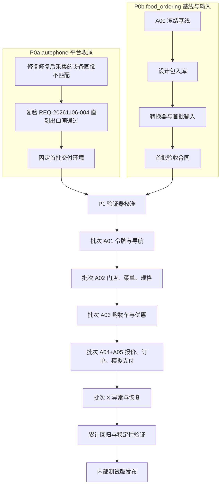
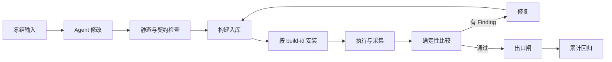

# commerce-v1 需求 UI 自动化交付推进方案

- 状态：草案，未开始执行
- 编写日期：2026-11-06
- 适用范围：food_ordering 自取交易主链（设计任务 A00–A05）
- 平台：autophone（设计转换、设备驱动、确定性比较、流程协调与报告）

## 1. 目标与边界

本方案通过一组连续的功能交付批次证明以下流程有效：

1. 输入稳定：设计稿、规则、fixture 与验收合同冻结后才进入开发。
2. Agent 开发：由 Agent 依据冻结输入修改产品代码。
3. 确定性验证：通过已注册动作、Operation 与确定性断言判定结果，多轮修复直到出口闸通过。
4. 发布收口：被验收的源码与实际发布产物之间可以建立身份关系。
5. 全程记录：每一轮的输入、调用、修改、构建、证据与结果均可复核。

### 1.1 已确认的决策

| 编号 | 决策 | 结论 |
| --- | --- | --- |
| D1 | 产品代码基线 | `food_ordering` 的 `main`；决策时为 `c9df2cb`，实际基线 SHA 由 B1 记录 |
| D2 | 首个发布目标 | 包含模拟支付的内部测试版本；真实支付与公开分发列为后续范围 |
| D3 | 设计包位置 | 原始包放 `design/commerce-v1/`；平台输入放 `.autophone/requirements/<key>/` |

### 1.2 本阶段排除项

- 真实收款、生产凭据和真实用户数据。
- App Store 或公开渠道分发。
- 设计任务 A06–A10（Duo、外送、会员、运营、AI 选餐等），以及 P1/P2 功能。
- 多 VM 业务并发。首阶段只使用一台已验证的 upstream Rig。

## 2. 输入材料现状

| 对象 | 现状 | 处理 |
| --- | --- | --- |
| 设计包 | `food-ordering-design/1.0.0`，54 个文件，SHA-256 已逐一重算一致；`MANIFEST.json` 的 SHA-256 为 `ec6bed1c5fbae3eb4d7cca23dbb1a78c573906b08b52a062e93812f604c174ee` | 原样迁入 `design/commerce-v1/`，不修改 |
| 设计包自检 | 包内记录静态检查 31/31、原型检查 33/33，本方案未重跑 | 只作为设计包证据，不作为产品验收结果 |
| 任务图 | `agent/tasks.json` 中有 A00–A10，依赖关系已定义 | 批次直接沿用 A 编号 |
| 验收用例 | 60 条，状态均为 `specified_not_executed` | 按批次转为可执行合同 |
| 画布 | 设计 PNG 为 390×844；平台编译器要求 1290×2796（430×932 @3x） | 按目标画布重新排版和渲染，不拉伸图片 |
| 输入格式 | 设计包格式与平台的 `structured-design-package/v1` 不同 | 新建转换步骤，记录映射缺口 |
| 产品形态 | Expo / React Native（expo-router） | 发布链按 Expo 构建与签名单独评估 |
| 后端 | 仓库没有服务端；A04/A05 需要报价、幂等订单和支付查询服务 | 新增模拟交易服务，见风险 R2 |
| 产品仓库指令 | 没有 `AGENTS.md` | 准备阶段补齐 |

## 3. 职责与存放位置

| 内容 | 位置 |
| --- | --- |
| 本方案、批次记录、发布记录、证据索引 | `food_ordering/docs/commerce-v1/` |
| 原始设计包（不可变） | `food_ordering/design/commerce-v1/` |
| 平台输入（转换产物、fixture、期望、哈希清单） | `food_ordering/.autophone/requirements/<key>/` |
| App、模拟交易服务、产品测试、发布配置 | `food_ordering` |
| 原始运行证据 | autophone 证据存储；产品仓库只保存 run ID、哈希与报告入口 |
| 设计转换器、设备驱动、比较器、报告等通用能力及缺口修复 | `autophone` |

平台缺口在 autophone 建关联任务修复，修复后回到原产品批次收口。

## 4. 总体推进



P0a 与 P0b 可以并行。P0a 是开始正式开发批次之前唯一的硬性前提。

## 5. 阶段说明

### 5.1 P0a：平台收尾（autophone）

背景：`REQ-20261106-004` 完成了"检测文案差异 → Codex 分析 → 应用修改 → Release 构建 → 受管安装"，但在修复后的采集阶段失败：

```text
device_profile 'vphone-ios26-default' does not match guest iOS 27.0.1
```

待验证线索：`autophone/workflow/ui_verification/ui_verification_food_ordering.py` 中有常量 `EVAL_DEVICE_PROFILE = "vphone-ios26-default"`，该常量被 `_l1`、`_baseline`、`_expected` 模块直接用作 `device_profile`；而 `autophone/device/target.py` 已经为 `upstream_v1` 映射了 `vphone-ios27-default`。错误值经由哪条调用链进入，尚未确认。

| 步骤 | 内容 | 完成判据 |
| --- | --- | --- |
| A1 | 追踪设备画像从工作流到修复执行器、再到采集请求的传递；修复并补回归测试 | 修复前回归测试失败、修复后通过；相关 contract/unit 层测试通过 |
| A2 | 确认服务与源码版本一致，按既有恢复机制复验该文案样本 | 新构建上比较为正向、Finding 关闭、出口闸通过并生成报告；本次失败保留在记录中 |
| A3 | 固定首批交付环境 | 环境清单写入本仓库 `docs/commerce-v1/environment.md`：VM、协议、设备画像、vphone-cli 与 autophone 的 SHA、工具版本、输入格式版本；2026-11-06 已完成，见 [environment.md](environment.md) |

### 5.2 P0b：基线与输入准备（food_ordering，对应 A00）

| 步骤 | 内容 | 完成判据 |
| --- | --- | --- |
| B1 | 记录 `main` SHA，运行现有脚本与测试，区分已有失败；补 `AGENTS.md`，写明冻结输入、禁止项和产品约束 | `docs/commerce-v1/baseline.md` 记录 SHA、命令与结果；不改 UI；2026-11-06 已完成，见 [baseline.md](baseline.md) |
| B2 | 原始设计包迁入 `design/commerce-v1/` | 重算 54 个文件的哈希全部一致；之后的变更只能以新版本出现；2026-11-06 已完成，见 [design-package.md](design-package.md) |
| B3 | 建设计转换：设计包 → `structured-design-package/v1`，按 430×932 重排渲染 | 转换器版本、源哈希与产物哈希写入转换回执；映射缺口登记为清单 |
| B4 | 首批（A01）验收合同：用例转为已注册动作、确定性断言、观测来源、比较策略、超时与恢复条件；固定 fixture、时钟、账号与命名空间 | `workflow input verify` 重算全部命中；阈值在此冻结 |

规则：截图、结构化设计与业务规则冲突时，先登记冲突并发布新输入版本，开发 Agent 不得自行选择。

### 5.3 P1：验证器校准

用隔离的受控变更证明验证器能发现错误。这些用例不计作开发缺陷。

| 受控错误 | 期望结果 |
| --- | --- |
| 界面金额错误，内部 JSON 正确 | 判失败 |
| 内部状态为支付成功，服务端仍为待支付 | 判失败 |
| 重复提交创建两笔订单 | 判失败 |
| 按钮存在但被遮挡或不可点击 | 判失败 |
| 当前运行引用旧构建或旧设计的证据 | 拒绝准入 |

前两项依赖模拟交易服务，可以在 A04/A05 批次之前补做；其余三项在首个开发批次之前完成。

### 5.4 P2：功能交付批次

每个批次都执行同一闭环：



| 批次 | 设计任务 | 功能 | 用例 | 需要证明的能力 |
| --- | --- | --- | --- | --- |
| 1 | A01 | F01、F02、F12 | T001–T004、T039–T042 | 令牌与导航可依据设计实现，旧评测与别名不受影响 |
| 2 | A02 | F03、F04、F05 | T005–T015 | 多页面实现，控件、状态与业务动作一一对应 |
| 3 | A03 | F06、F07 | T016–T022 | fixture 贯通 UI 与计算；legacy-v1 与 commerce-v1 分离；旧功能回归通过 |
| 4 | A04+A05 | F08、F09、F10 | T023–T035 | 服务端报价、幂等、异步支付结果和独立读回进入验收 |
| X | A05 补充 | 异常态 | 报价过期、支付未知、换店冲突、重启恢复 | 失败可恢复，不会误报成功 |

批次与修复轮次分开编号。允许一次通过，不为了演示而刻意制造失败。

首条端到端演示路径：选店 → 两份套餐 → 满 60 减 10 → 应付 5980 分（6580 + 400 − 1000）→ 创建唯一订单 → 模拟支付 → 取餐状态。

### 5.5 P3：累计回归与稳定性

- 全部批次用例与异常用例在最终候选构建上通过。
- 最终候选执行三次独立复位后的重复验证，保留全部尝试。该判据只说明本次实验的稳定性，不代表生产可靠性。
- 失败后不得临时放宽阈值；需要调整合同时发布新版本，并重验受影响的范围。

### 5.6 P4：内部测试版发布

1. 发布构建具备完整的源码、依赖与产物身份。
2. 在发布配置下完成必要验证；重签名或重构建的产物另行记录。
3. 完成安装、升级、持久化兼容与回滚检查。
4. 准备分发对象、发布说明、已知限制和监测方案。
5. 在明确授权的范围内分发，保存回执，并完成发布后冒烟。

autophone 的 `release_manager` 只管理 autophone 自身的发布，不覆盖 food_ordering 的分发链。

## 6. 验收分层

| 对象 | 判据 | 主要证据 |
| --- | --- | --- |
| UI | 文案、按钮状态、位置、颜色、遮挡、可操作性 | 截图、系统 AX、冻结设计条款 |
| 金额 | 独立期望值与报价响应、界面显示一致 | 报价响应、界面读取、fixture 期望 |
| 交易 | 重复提交只产生一单；支付状态未知时先查单 | 服务端订单、支付记录、事件读回 |
| 恢复 | 重启后订单一致；换店冲突有明确处理 | 前后状态、操作轨迹、持久化读回 |
| 身份 | 设计、源码、构建、安装、运行属于同一交付链 | 哈希、Build Record、安装回执、Artifact Manifest |

- App 内部观测只用于定位，不能作为业务成功的唯一证据。
- 期望值不能调用被测业务函数计算。
- 正式回归运行期不依赖 AI 临场判定。

## 7. 过程记录

| 文件 | 内容 |
| --- | --- |
| `docs/commerce-v1/delivery-plan.md` | 本方案 |
| `docs/commerce-v1/baseline.md` | A00 基线、已有失败 |
| `docs/commerce-v1/environment.md` | 首批交付环境 |
| `docs/commerce-v1/input-conversion.md` | 转换回执索引与映射缺口 |
| `docs/commerce-v1/batches/<批次>.md` | 每批次的轮次记录 |
| `docs/commerce-v1/release-internal-1.md` | 发布记录 |
| `docs/commerce-v1/summary.md` | 跨批次汇总与指标 |

每轮至少记录：

| 类别 | 字段 |
| --- | --- |
| 输入 | 需求 key、设计版本、fixture、验收合同及哈希 |
| Agent | 实际模型、任务输入、调用记录、修改范围、耗时、可取得的费用 |
| 代码与构建 | 基线 SHA、修改 SHA、diff、Build ID、产物哈希、安装回执 |
| 验证 | 用例版本、环境、截图与 AX、业务读回、比较结果 |
| 修复 | Finding、原因假设（标明待验证）、修改内容、关闭证据 |
| 结果 | 通过、失败、阻塞、未覆盖范围；人工介入的动作与原因 |

报告由原始证据生成：`report-local` 生成审计报告，`report-story` 生成过程展示，`stage report` 生成阶段明细。汇总列出全部轮次，包括失败轮次（含 P0a 的 `REQ-20261106-004`）。

流程有效性指标：首次通过率、修复轮数、重复运行一致性、受控错误检出率、旧功能回归结果、人工介入次数、总耗时、证据缺失项。

## 8. 风险与待定事项

| 编号 | 事项 | 影响 | 处理 |
| --- | --- | --- | --- |
| R1 | 设备画像不匹配的根因未确认 | 阻塞所有修复后复验 | P0a 处理 |
| R2 | 仓库没有后端，A04/A05 需要模拟交易服务 | 决定交易验收的独立读回从哪里取得 | 在批次 4 前确定服务的形态、部署位置（宿主或 VM 可达）、数据隔离与清理回执 |
| R3 | 设计包格式与平台格式之间存在映射缺口 | 部分状态可能无法转换为可执行合同 | B3 登记缺口；缺口属于平台能力时在 autophone 建任务 |
| R4 | 重新布局到 430×932 可能改变设计意图 | 参考图与原设计不一致 | 重排结果作为新设计版本，记录与原包的差异 |
| R5 | Expo 发布构建与签名链未评估 | 影响 P4 | 在 P3 期间完成评估 |
| R6 | Figma 在线内容与导出包可能不一致 | 输入漂移 | 以冻结导出为准；Figma 变更须形成新版本 |

## 9. 近期执行顺序

1. P0a-A1：在 autophone 追踪并修复设备画像传递。
2. 同时进行 P0b-B1 与 B2：基线记录、`AGENTS.md`、设计包入库。
3. P0a-A2/A3：复验并固定环境。
4. P0b-B3/B4：转换器与 A01 验收合同。
5. P1 校准，随后进入批次 1。
